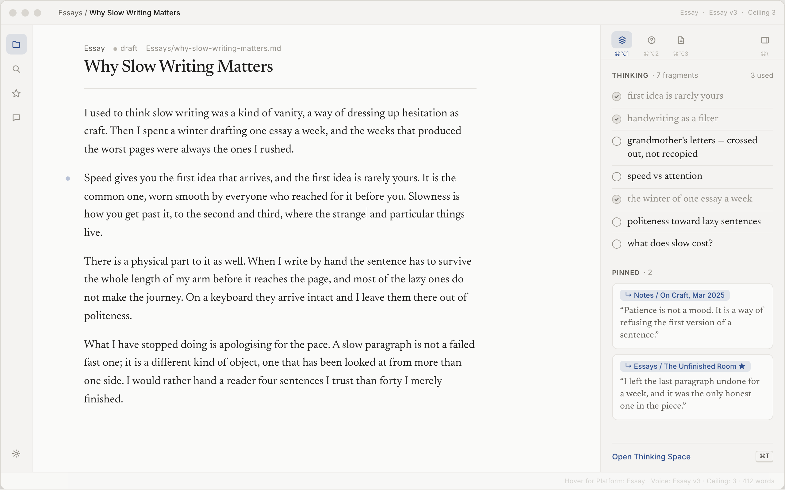

# Ekdanta

**Cursor + Obsidian for everyday writing.** A local-first writing app that knows your notes and your voice, and helps only when you ask, only as much as you ask.

<picture>
  <source media="(prefers-color-scheme: dark)" srcset="docs/images/editor-dark.png">
  
</picture>

> **Status: early MVP.** The editor and all five help levels work on real models. Knowledge import, voice profiles and the Thinking Space are next.

## Try it

You need [Node.js](https://nodejs.org) 20 or later (24 or later to import PDFs), and one way to reach a model: the [Claude Code](https://code.claude.com) CLI signed in, an `ANTHROPIC_API_KEY`, or [Ollama](https://ollama.com).

```sh
git clone https://github.com/iamshauryag/ekdanta.git
cd ekdanta/app
npm install
npm run dev            # then open http://127.0.0.1:5317
```

It opens a small sample vault. To write in your own folder of Markdown files (an Obsidian vault works), start it with `EKDANTA_VAULT=~/path/to/folder npm run dev`. See [`app/README.md`](app/README.md) for models and settings.

## Why

Most AI writing tools do too much. They finish the page for you, and in doing so they take the thinking away. Ekdanta is built the other way round. The page belongs to the writer, the AI stays silent by default, and when you do ask for help you choose exactly how much.

## The help ladder

Help is a ladder of five levels, each one keystroke away. Nothing appears while you type. Every suggestion comes because you asked for it.

| Key | Level | What you get |
|---|---|---|
| <kbd>⌘1</kbd> | **Recall** | Your own material: a note, a highlight, a past paragraph, always with its source |
| <kbd>⌘2</kbd> | **Nudge** | One question or direction, never prose |
| <kbd>⌘3</kbd> | **Word** | A few options for the next word, or replacements for the one you've selected |
| <kbd>⌘4</kbd> | **Sentence** | A continuation or rewrite of one sentence, shown as a diff |
| <kbd>⌘5</kbd> | **Passage** | A rewrite of a selected passage on your instruction, shown as a diff |

You can set a ceiling ("never above level 3 unless I ask"). Generating whole pages is deliberately not a feature. In browsers that keep ⌘+number for switching tabs, use ⌥ (Option) instead.

## Principles

- **Nothing changes without a diff.** Every edit to your words is a word-level diff you accept or reject, and the diff is computed by code, not by the model.
- **Show the source.** Anything drawn from your knowledge links back to the note or highlight it came from.
- **Your voice, per platform.** Ekdanta learns how you write essays, posts, emails and messages from the pieces you mark as your best, and keeps that profile in a file you can read and edit.
- **Think before drafting.** A Thinking Space lets you dump loose fragments on a canvas. Ekdanta links and clusters them but never rewrites them.
- **Your files, plainly.** Plain Markdown, YAML front-matter and [JSON Canvas](https://jsoncanvas.org) in a folder you own. Ekdanta is compatible with [Obsidian](https://obsidian.md) vaults.
- **Private by default.** Ekdanta is local-first, with no hosted backend and no telemetry. Recall runs on a small model inside the app. For the other levels, use an AI CLI you're already signed in to, your own API key, or a local model through Ollama.

## Documents

- [Product specification](docs/SPEC.md): vision, AI approach, architecture and MVP scope
- [Design brief](design/BRIEF.md): principles, visual direction, the editor layout and the right panel
- [Flows](design/FLOWS.md): screens, shortcuts, files on disk and the core user flows
- [The help ladder](design/HELP-LADDER.md): exactly how each help level behaves
- [Design system](design/DESIGN.md): colour, type, spacing and components
- [Mockups](design/mockups/): static HTML mockups (open them in a browser)

## Stack

React and TypeScript with a [CodeMirror](https://codemirror.net) editor, served by a small local Node server. The plan is to package it as a [Tauri](https://tauri.app) desktop app.

## License

[MIT](LICENSE) © 2026 Shaurya Gupta
